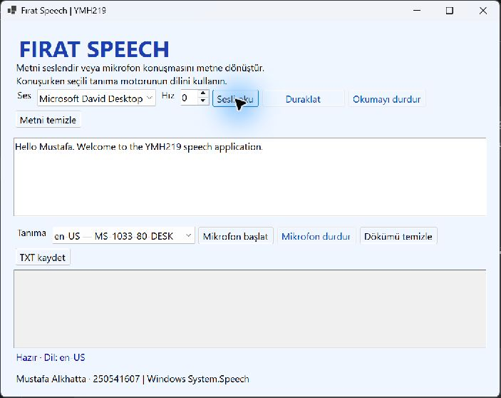
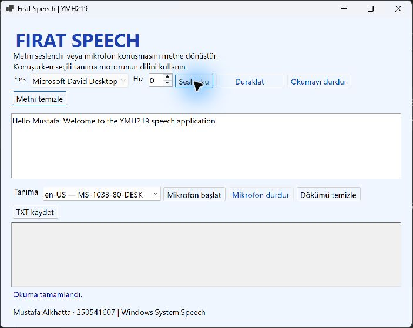

# Fırat Speech — YMH219

Windows Forms üzerinde iki yönlü ses/metin uygulaması: metni seslendirme ve mikrofondan konuşmayı metne dönüştürme.

**Öğrenci:** Mustafa Alkhatta — **250541607**

## Teknolojiler
C#, .NET 10, Windows Forms, NuGet `System.Speech` **10.0.0**, Windows SAPI.

## Kurulum ve çalıştırma
Windows 10/11 ve .NET 10 SDK gereklidir. Visual Studio'da .NET masaüstü iş yüküyle `SpeechApp.csproj` açılabilir.

```powershell
git clone https://github.com/MustafaAlkhattab/YMH219-SpeechApp.git
cd YMH219-SpeechApp
dotnet restore
dotnet build -c Release
dotnet run -c Release
```

Windows'ta en az bir masaüstü TTS sesi bulunmalıdır. Mikrofon girişi için System.Speech ile uyumlu bir **masaüstü konuşma tanıma motoru**, mikrofon ve Windows mikrofon erişimi gerekir. Uygulama kurulu motorları listeler. Örneğin en-US motoru seçiliyse İngilizce konuşulmalıdır; Türkçe motor kurulu olmadan Türkçe dikte vaat edilmez. Eksik altyapı veya erişim hatası arayüzde açıklanır.

## Temel özellikler ve kullanım
- Üst alana metin yazın, ses ve hız (-10…10) seçin, **Sesli oku** düğmesine basın.
- **Duraklat / Devam** ve **Okumayı durdur** ile oynatmayı yönetin; **Metni temizle** alanı siler.
- Alt araç çubuğunda tanıma dilini seçip **Mikrofon başlat** kullanın. Konuşma, saat ve güven değeriyle alt alana eklenir.
- **Mikrofon durdur**, **Dökümü temizle** ve **TXT kaydet** bulunur.
- Okuma ve mikrofon aynı anda çalıştırılmaz; kendi çıktısının yanlışlıkla dikteye alınması önlenir.
- Durum etiketi aktif işlemi ve hataları gösterir. İşlemler asenkrondur; kaynaklar pencere kapanışında serbest bırakılır.

## Nesne tabanlı tasarım
`SpeechService` sentezleyiciyi, tanıyıcıyı ve yaşam döngülerini kapsüller; olaylarla arayüze haber verir. `Form1` kontrolleri ve kullanıcı hatalarını yönetir. Arka plan sonuçları BeginInvoke ile arayüze aktarılır.

## Ekran görüntüleri



## Kontrol ve bilinen sınırlamalar
- Release derlemesi 0 hata / 0 uyarı ile geçti.
- Microsoft David Desktop sesi ve en-US masaüstü motoru bulundu; örnek metnin TTS işlemi başlatıldı ve tamamlanma olayı doğrulandı.
- Canlı mikrofon diktesi, duraklatma/devam ve TXT dışa aktarma kullanıcıyla birlikte ayrıca denenmelidir; doğrulanmış sayılmamıştır.
- Doğruluk mikrofon, gürültü ve dil motoruna bağlıdır. Güven değeri doğruluk garantisi değildir.
- Farklı bilgisayarda çalışma henüz denenmedi. Uygulama ses kaydını dosyaya almaz veya bulut servisine göndermez.

## Sözlü hazırlık ve kaynak
DictationGrammar serbest konuşma içindir; SpeechRecognized tanınan sonucu getirir. RecognizeAsync arayüzü bekletmez. IDisposable kaynakların kapatılması mikrofonun açık kalmasını önler.

[Microsoft SpeechRecognitionEngine belgesi](https://learn.microsoft.com/en-us/dotnet/api/system.speech.recognition.speechrecognitionengine)
